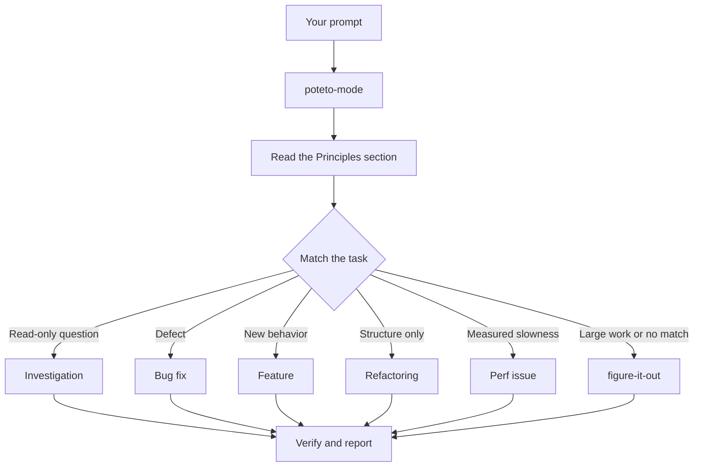

<a id="route-work-through-poteto-mode"></a>

# 作業を `/poteto-mode` 経由でルーティングします

`/poteto-mode` は正面玄関です。目標を与えると、23 のプレイブックの 1 つと一致し、そのプレイブックのステップを ToDo リストにコピーし、ステップで必要な他のスキルを呼び出します。このページでは、適切なプロンプトがどのようなものであるか、そして実際に必要なプロンプトがどれほど少ないかを学びます。


<a id="what-happens-to-your-prompt"></a>

## プロンプトはどうなりますか



この図は一般的なルートを示しています。また、メトリクスのヒルクライム、ランタイムの症状とキャプチャされたトレースの診断、プロトタイプ、視覚的パリティ、スキルの作成と評価、自律実行、PR またはスタックのマージ準備のベビーシッター、検証済みスタックのリリース、自動操縦での PR キューの実行、プロジェクト規模のプログラムのオーケストレーション、セッションのピックアップ、安全な一時停止、マルチフェーズ計画、およびワークツリーのクリーンアップのためのプレイブックもあります。 [プレイブック ディレクトリ](../../skills/poteto-mode/playbooks/) にはフルセットが含まれています。

<a id="say-the-goal-not-the-ceremony"></a>

## セレモニーではなくゴールを言いましょう

仕様を書きません。問題点や要望に加えて、エージェントの時間を節約するために既に知っていることをすべて伝えます。

```text
/poteto-mode users get two notifications after a retry. repro first, then fix and verify.
```

これはバグ修正のプロンプトです。 「再現第一」は礼儀正しさではなく実際の制約であり、プレイブックではそれが尊重されています。 ToDo リストがバグ修正の手順で満たされるのを確認してください。スキップされたステップは `skip: <reason>` で表示されたままになります。

<a id="what-goes-in-a-prompt"></a>

## プロンプトに表示される内容

便利なプロンプトには最大 5 つの内容が含まれており、それぞれが文に収まります。

- **目標。** 何が問題なのか、何が欲しいのかを言ってください。
- **チェックが完了しました。** 合格または不合格でなければなりません。 「もっと良くする」「1時間取り組む」はチェックではありません。
- **見たい証拠。** 実際のコマンド出力、フローのビデオ、保存された値、または前後の数値を求めてください。
- **すでにご存知のこと** 症状、再現手順、ログ行、またはリンクにより、エージェントは検索を省略できます。
- **実際の制約。** 「最初に再現する」、「まだコードを変更しない」、「動作変更なし」、および「続行する前に確認させてください」は、それぞれエージェントの動作を変更します。

5 つすべてを含む 1 つのプロンプトを次に示します。

```text
/poteto-mode the csv export drops its last row since yesterday's deploy. failing job id is 4812. repro first, then fix. done means the 60k-row fixture exports every row. show me the row counts before and after.
```

省略する価値のあるものが 2 つあります。

- **方法。** 何を達成するかを伝え、エージェント ルームを出て、自分が選択する道よりも良い道を見つけます。同じことがスキルのリストにも当てはまりますが、以下の落とし穴で説明されています。
- **最初は原因に関するあなたの理論です。** 推測が述べられているため、検索範囲があなたが指定した場所に絞り込まれます。あなたの直感を共有する前に、エージェントに問題を再度説明してもらいましょう。

長いスレッドや曖昧なバグなど、ノイズの多いレポートの場合は、最初のステップとして再記述を行います。

```text
/poteto-mode read this thread. restate the underlying issue in your own words, in plain english. don't change any code yet.
```

誤読は、コードが存在する前に再記述に現れます。そこで修正すると、間違った修正を 1 つ行う代わりに、メッセージが 1 つ必要になります。

<a id="follow-up-short"></a>

## 短いフォローアップ

会話にすでにコンテキストが含まれている場合、プロンプトはほとんど何も表示されなくなります。これらすべてで十分です。

```text
/poteto-mode do it
```

```text
continue
```

```text
keep going until done
```

Short が機能するのは、プレイブックが構造を保持し、カスタム モードが毎ターン `/poteto-mode` をコンテキスト内に保持するためです。 [PSTACK のセットアップ](./01-setup.md#run-your-first-task) を起動する方法を示します。言葉には意図が伝わり、スキルには厳しさが伝わります。

<a id="switch-tasks-with-new-task"></a>

## 「新しいタスク」でタスクを切り替える

長いチャットでは、最後のタスクからのコンテキストが蓄積されます。話題を変えるときは、次のように言います。

```text
/poteto-mode new task. figure out why the cache entry survives logout. don't change any code yet.
```

「新しいタスク」は、`/poteto-mode` に、前のプレイブックを続行するのではなく、再マッチングするように指示します。 「まだコードを変更しないでください」は、これを調査に固定します。これら 2 つのフレーズがないと、機能の途中のモードでは、質問が次の機能ステップとして扱われる傾向があります。

<a id="give-parallel-work-its-own-machine"></a>

## 並列作業に独自のマシンを与える

1 台のコンピューター上の 1 つのリポジトリに対して複数のエージェントを実行すると、それらは作業ツリー、ポート、ビルド出力をめぐって競合します。最もクリーンな分離は [クラウド サブエージェント](https://cursor.com/docs/subagents#cloud-subagents) です。それぞれが独自の VM とブランチを取得するため、マシンに触れることなく依存関係をインストールし、アプリを実行し、結果のビデオを記録できます。タスクの前に `/in-cloud` と入力するか、親チャットに作業をクラウド サブエージェントに渡すように依頼します。

作業をローカルに留める必要がある場合は、事前にワークツリーを要求します。

```text
/poteto-mode new task. branch off <base> in a fresh worktree, then port the parser change there.
```

独自のブランチとワークツリー内の各タスクは、エージェントが他のファイルを踏みつけないことを意味します。ワークツリーはディスクとマシンのリソースを消費するため、ラップトップでは一度に数台しか実行できません。 [PR プレイブックを開く](../../skills/poteto-mode/playbooks/opening-a-pr.md) はコード変更用のワークツリーからすでに機能しているため、通常、これを行うのは特定のベースまたは場所が重要な場合のみです。

ワークツリーが蓄積されます。ディスクがきつくなったら、次のように尋ねてください。

```text
/poteto-mode what's eating my disk? prune the worktrees that are safe to prune.
```

[ワークツリー クリーンアップ プレイブック](../../skills/poteto-mode/playbooks/worktree-cleanup.md) は、マージ状態、コミットされていない作業、およびまだワークツリーにアクセスしているチャットによってすべてのワークツリーを分類します。証拠がクリアしたもののみを削除し、コミットされていない作業を保持しているものに対する呼び出しを一時停止します。

<a id="leave-it-running"></a>

## 実行したままにします

立ち去るときは、完了の意味を言ってから次のように言います。

```text
/poteto-mode im stepping away. keep going until the migration check reports zero old callers. log your decisions.
```

[`/figure-it-out`](../../skills/figure-it-out/SKILL.md) を通じて後でルートを確認する作業。これにより、実行のフェーズが設計され、[`/show-me-your-work`](../../skills/show-me-your-work/SKILL.md) 決定ログが保存されます。 [寝ている間に仕事を実行](./07-overnight.md) は夜間契約全体をカバーします。

**落とし穴:** プロンプトでスキルを列挙しないでください (「/how を使用し、次に /architect を使用し、次に /arena...」を使用します)。プレイブックではすでにそれらのシーケンスが設定されており、手書きのシーケンスでは通常、プレイブックで保持されていたステップの順序が変更されたり、削除されたりします。特定の選択を上書きする場合にのみ、スキルに名前を付けます。

完全なルーティング ルールについては、[`poteto-mode`](../../skills/poteto-mode/SKILL.md) 自体を読み取ります。

次に: [コードを理解する](./03-understand.md)。
