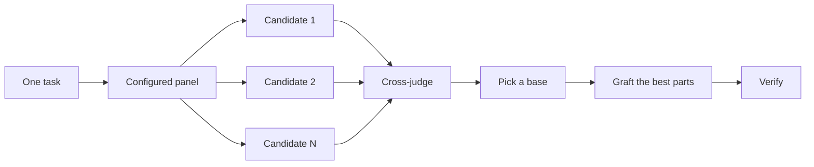

<a id="design-before-you-write-code"></a>

# コードを書く前に設計する

ハードなデザインを一度試みると、モデルが最初に考えた形状が固定されます。 `/architect` は、実装前に型と境界を決定します。 `/arena` は、同じブリーフで複数の試行を実行し、最良の部分をマージします。 `/interrogate` では、他のモデルが結果を壊そうとしています。ジョブがデザイン合成ではなくカバレッジである場合、`/swarm` はスライスまたはレースをファンアウトし、その結果を集約します。

最も一般的な 2 つの設計ミスは、エージェントの最初の設計を採用することと、コードがテストされていない計画を磨き上げることです。このページでは両方を修正します。コードを通じて計画を立てます。プロトタイプは未解決の質問に答え、README またはチュートリアルで目標を設定し、文書化された計画は最後に作成されます。


<a id="settle-the-shape-with-architect"></a>

## `/architect` で形状を確定します

```text
/architect design the import pipeline before writing any code. i care most about how callers use it.
```

[`/architect`](../../skills/architect/SKILL.md) は最初に自身を接地し、デザインが触れるコード上で `/how` を実行し、所有権またはレイヤーを移動するときに `/why` を実行します。次に、`/arena` を実行して競合する設計スケッチを作成します。最初に呼び出し元の使用方法がそれぞれに書き込まれ、その後に型、署名、モジュール マップが続きます。

デフォルトでは、合成されたデザインから実装に直接進みます。最初にデザインを確認したい場合は、次のように言います。

```text
/architect with checkpoint. stop and show me before implementing.
```

コードが開始されると、デザインは神聖なものではなくなります。実装が関係のない場所で同じ回避策を示したり、`any` または強制キャストでのみコンパイルする型を示した場合、`/architect` はそれを設計が間違っている証拠として扱います。スケッチを破棄して、パッチを適用するのではなく、最初からやり直します。

<a id="fan-out-attempts-with-arena"></a>

## `/arena` によるファンアウト試行

```text
/arena take my prompt to the arena verbatim. i want to compare their proposals with yours.
```

[`/arena`](../../skills/arena/SKILL.md) はその下の一般ツールです。 N 個のサブエージェントが同じ設計またはコード ブリーフを並行して試行し、それぞれが独自のワークツリーまたはディレクトリに書き込みます。読み取り専用の審査員は、構成で許可されている場合は別のモデル ファミリで、ルーブリックに照らしてすべての候補者を採点します。コーディネーターは各候補を端から端まで読み、ベースを選択し、敗者からの最良のアイデアを移植して、結果を検証します。



パネルは [`/setup-pstack`](../../skills/setup-pstack/SKILL.md) 構成から取得され、タスクごとに調整できます。決定が重要な場合にはより多くの候補者を求め、そうでない場合には候補者を減らします。

```text
/arena this, 5 candidates. the cache key format is expensive to change later.
```

<a id="cover-slices-and-races-with-swarm"></a>

## `/swarm` でスライスとレースをカバーします

```text
/swarm check every package under packages/ against its check.sh. one worker per package. one report.
```

[`/swarm`](../../skills/swarm/SKILL.md) は、独立したスライス、カバレッジ マトリックス、ガントレット レーン、探索パーティション、または宣言されたレース アームにわたって N 個のワーカーをファンにします。各ワーカーは独自のスコープを取得してチェックし、`PASS`、`ISSUES`、または `BLOCKED` を報告します。親はワーカーを待ち、ギャップやドロップアウトを含む 1 つのコンパクトなレポートを返します。

並列処理によりカバレッジを獲得したり、独立したチェックを競合させたりする場合に使用してください。 `/arena` は、すべての作業者に同じ設計またはコード概要を与え、ベースを選択して最良の部分を接ぎ木します。 `/swarm` は、スライスをカバーするか、事前に宣言された選択ルールでレースを実行します。根元の選択と接ぎ木の儀式は使用しません。

<a id="break-it-with-interrogate"></a>

## `/interrogate` で中断します

```text
/interrogate the whole branch, but skeptically. no nitpicks unless it's an actual bug or regression.
```

[`/interrogate`](../../skills/interrogate/SKILL.md) は、同じ差分、インテント、ルーブリックを異なるモデル ファミリのレビュー担当者に送信します。モデルの多様性がポイントです。モデルが異なれば盲点も異なるため、2 つのモデルが独立して上昇することが判明した場合は、信頼性の高いシグナルとなります。リーダーはすべてを `Act on`、`Consider`、`Noted`、`Dismissed` に分類し、それぞれの解雇理由を付けて、自動的には何も適用しません。

解雇も読んでください。リーダーは神託ではなく現実的な上級エンジニアであり、それを上書きすることができます。

<a id="prototype-instead-of-debating"></a>

## 議論する代わりにプロトタイプを作成する

最初のデザインは決して採用しないでください。いくつか質問して、目に見える証拠から選んでください。

```text
/poteto-mode prototype a few options for the new dropdown menu. take screenshots or videos for me to compare.
```

[プロトタイプ プレイブック](../../skills/poteto-mode/playbooks/prototype.md) は、スクラッチ ディレクトリに使い捨てスケッチを構築し、バリアントを 1 つのスイッチャーの背後に配置し、それぞれを駆動して、スクリーンショットまたはタイミングをキャプチャします。 UI だけでなく、動作やアルゴリズムにも機能します。プロトタイプはコードで計画しています。あなたに質問する代わりに何かを実行することで、エージェント自身が未解決の質問に答えられるようにし、あなたが思いつかないようなオプションを選択できる余地を残します。

同じアイデアが実際の設計にスケールアップされます。 `/architect` をプロトタイプと組み合わせて、レビューゲートを維持します。

```text
/poteto-mode we need rate limiting for external webhooks. /architect it first, and answer open questions with prototypes. let me review before proceeding.
```

抽象的な計画にレビュー担当者を費やさないでください。 `/interrogate` は差分に属します。背後にコードのない計画に敵対的レビューを向けると、レビュー担当者は理論上のリスクや決して起こらないエッジケースをでっち上げます。プロトタイプで疑問を解決してから、構築されたものをレビューします。

<a id="write-the-readme-first-for-shared-code"></a>

## 共有コードについては最初に README を作成してください

他のコードが使用するパッケージまたは API については、ユーザーが読むドキュメントから始めます。

```text
/poteto-mode write a tutorial for how i would use the new config package first. then /teach me why it beats the current one.
```

最初にチュートリアルを作成すると、呼び出し元のビューが強制されます。 API を仮想のユーザーに説明し、実装に戻ります。ドキュメントは、エージェントが自身の作業をチェックする具体的なターゲットにもなります。ドキュメント自体が重要な場合は、[`/technical-writing`](../../skills/technical-writing/SKILL.md) という名前を付けます。これにより、チュートリアルは参照と説明にすぐに移行するのではなく、チュートリアルのままになります。

<a id="plan-after-the-design-settles"></a>

## デザイン確定後のプラン

pstack には意図的に計画スキルがありません。書面による計画が必要な場合は、デザインが決定してから要求してください。

```text
/poteto-mode turn this design into a plan. small verifiable PRs, each with its own verification steps.
```

[マルチフェーズ計画プレイブック](../../skills/poteto-mode/playbooks/multi-phase-plan.md) は、プロトタイプによって残りの未解決の質問を解決し、PR ごとに 1 つのセクションを作成し、それぞれのセクションが変更が機能することの証明で終わります。テストスイートに合格しただけではその証明としてカウントされません。計画は成果物です。 プレイブック はこれを実装せず、次にどの実行 プレイブック が実行するかを指定します。

移行の場合は、プロンプトにバーを入力します。

```text
/poteto-mode plan the migration of our ui library to the new styling system. small verifiable PRs, each with visual regression checks. the result must match the original exactly, bugs included.
```

「バグが含まれている」ため、移行が途中で静かに修正されることがなくなり、古い出力と新しい出力を比較できなくなります。数日に渡るプロジェクトの場合、計画をしばらくリポジトリにコミットして、他のエージェントが進行中の作業を確認できるようにすることができます。作業が完了したら削除します。

<a id="how-much-design-work-does-a-task-deserve"></a>

## タスクにはどれくらいの設計作業が必要ですか?

すべての変更にこれが必要かどうか疑問に思われるかもしれません。いいえ、ほとんどの変更は必要ありません。ラフなはしご:

- 完成したかどうかわからない小さな変更には、`/interrogate` だけが必要です。
- 関数の境界を越えたり、所有権を移動したりする変更は `/architect` を獲得し、それに伴い `/arena` が発生します。
- 名前、形式、アルゴリズムなど、独立した試みが役立つスタンドアロンの決定は、直接 `/arena` です。
- カバレッジ マトリックス、一連の並行チェック、または宣言された武器を持つレースは `/swarm` です。
- レイアウト、タイミング、アプローチなど、何かを実行することで答えられる未解決の質問は、議論ではなくプロトタイプを取得します。
- 覆すのにコストがかかる係争中のデザインは、リリース前に `/architect` を取得し、次に `/interrogate` を取得します。
- 複数の PR にまたがる作業には、設計が落ち着いた後に作成される計画が作成されます。

`/poteto-mode` はすでにこのラダーを適用しています。境界を越える作業では `/architect` が自動的にトリガーされるため、主にデフォルトより多かれ少なかれ精査が必要な場合にこれらに直接アクセスします。

次に: [変更をビルドしてクリーンアップ](./05-build-and-clean.md)。
