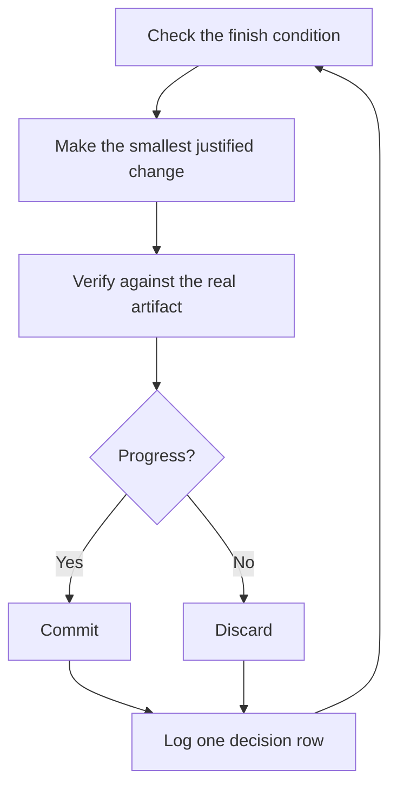

<a id="run-work-while-you-sleep"></a>

# 寝ている間に仕事を実行

これは、これまでのすべての代償です。自身の作業を検証するために信頼できるエージェントは、困難なタスクを任せることができるエージェントです。それを安全にするのは希望ではありません。それは、チェック可能な終了条件、分離されたワークツリーまたはクラウド エージェント、そして朝に監査する意思決定ログです。


<a id="earn-the-trust-before-the-loop"></a>

## ループ前に信頼を獲得する

信頼できないループは、チェックされていない作業をより速く生成するだけで、反復のたびに混乱が悪化します。実行したままにする前に、それが取得されていることを確認してください。

- あなたはそのタスクを一度手動で実行したか、エージェントが実行するのを見たことがあるので、どのようなものが良いかを知っています。
- エージェントには、検証スキル、プロファイラー、ログなど、ユーザー自身が使用するツールとシグナルが備わっています。
- すべての段階でその成果が証明され、成果がバーを外した場合にはラインが停止する可能性があります。
- あなたはいくつかの記録を読み、繰り返された失敗をツール、スキル、またはチェックに変えました。

4 つすべてが保持された後にのみループを自律的にします。それまでは、見ながら実行してください。

<a id="the-overnight-contract"></a>

## 一晩の契約

優れたハンドオフには、ゴール、終了条件、権限、および脱出ハッチが含まれています。長くする必要はありません。

```text
/poteto-mode im going to bed. migrate every caller to the new parser in a fresh worktree off <base>.
done means zero old callers, all parser fixtures pass, old api deleted.
keep a decision log. don't ask me before committing.
/loop until done. if you're truly stuck after a few hours, stop and write up why.
```

各ラインで何が得られるのかを見てみましょう:

- 「就寝します」はセッションのオーバーライドです。エージェントは質問をやめて続行します。
- 「done means...」は、目標をすべての反復を実行できるチェックに変換します。
- 「`<base>` から新しいワークツリーを削除」すると、実行が開いている他のものと衝突することがなくなります。
- 「コミットする前に質問しないでください」は、エージェントがブロックする権限を事前に回答します。
- `/loop` は Cursor の組み込みウェイク メカニズムであり、pstack スキルではありません。 [Autonomous run プレイブック](../../skills/poteto-mode/playbooks/autonomous-run.md) は、これを使用してイベントまたはハートビートの終了条件を再チェックします。
- 脱出ハッチを使用すると、本物の行き止まりで停止し、その理由を書き出すことができます。これにより、クリエイティブな目標を再解釈する 8 時間の時間を短縮できます。

作業を終了した後にこの作業をレビューするため、`/poteto-mode` は [`/figure-it-out`](../../skills/figure-it-out/SKILL.md) を介してこの作業をルーティングします。これにより、コードの前に実行のフェーズが設計され、決定ログに配線されます。

実行を意図的に停止するには、エージェントに一時停止するか、オフラインにするか Cursor を再起動しようとしていることを伝えます。 [安全に一時停止するプレイブック](../../skills/poteto-mode/playbooks/pause-safely.md) は、現在のステップを終了またはバックアウトし、進行中の作業チェックポイントをコミットし、再開メモを書き込みます。新しいチャットは、セッション ピックアップ プレイブックを通じてそのメモから作業をピックアップします。 「続けて」と言っても決して一時停止することはありません。

<a id="what-the-loop-does-all-night"></a>

## ループが一晩中何をしているか



1 つの変更、1 つのチェック、1 つのログ行、各反復。役に立たなかった変更は放置せずに破棄しました。プラトーは停止ではなく回転を意味し、勝利を宣言するためにフィニッシュコンディションが静かに緩むことはありません。

<a id="the-morning-audit"></a>

## 午前の監査

[`/show-me-your-work`](../../skills/show-me-your-work/SKILL.md) は実行をレビュー可能にするものです。各行は、時刻、フェーズ、決定、理由、証拠ポインタ、および結果を TSV の `decisions.tsv` (複数の実行がディレクトリを共有する場合は `.audit/<task-slug>.tsv`) に記録します。デフォルトではローカルのままです。作業が野心的で、レビュー担当者が結果を信頼するための証跡が必要な場合にコミットします。

戻ったら、レビュー フォームでの実行を依頼してください。

```text
/show-me-your-work catch me up on what you did last night
```

スキルが概要を返す前に、別のモデル ファミリでレビューアーを生成して証跡とトランスクリプトを読み取り、応答は精査に値するものをリストした「注意」セクションで終わります。まずそのセクションを読んでから、そのセクションが指しているログ行を読んでください。あなたは決定を監査しているのであって、一晩中読み直しているのではありません。

<a id="when-the-night-holds-a-queue-not-a-task"></a>

## 夜がタスクではなくキューを保持しているとき

上記のコントラクトは、1 つのタスクを 1 つの終了条件に導きます。夜によっては、さらに多くのイベント、独立した変更のキュー、またはプログラム全体が開催される場合もあります。 3 つの プレイブック が同じ信頼をスケールアップします。

[オートパイロットフル](../../skills/poteto-mode/playbooks/autopilot-full.md) は、マージする独立した PR のキューを実行します。各 PR には、ビルドからマージまで PR を実行する 1 つのオーナー エージェントが与えられますが、独自の判定に基づいてマージするオーナーは存在しません。新しい検証者の群れは、所有者のコード準備完了の頭からラウンドを開始し、パッチを変更するその後のプッシュごとにラウンドを開始します。マージするパッチに対するクリーンな判定のみがマージを許可します。

```text
/poteto-mode full autopilot on this queue. each item is independent. i want them merged by morning.
```

[Autopilot-stack](../../skills/poteto-mode/playbooks/autopilot-stack.md) は同じ所有者ループを実行しますが、何も送信しません。すべてのリンクについて検証者の判定が行われた 1 つの線形ベース ブランチ スタックに目覚め、それを自分でレビューして着陸します。変更が結合される場合、または何かがマージされる前に作業を自分の目で確認したい場合は、Autopilot-full よりも選択します。

```text
/poteto-mode autopilot these five changes but stack them, don't ship. i'll land the stack in the morning.
```

[オーケストレーション](../../skills/poteto-mode/playbooks/orchestrate.md) は、単一のエージェントよりも長く存続するプログラム用です。複数日に渡る、多数の積み重ねられた PR、1 人の常駐コーディネーター チャットの下でのサブエージェントのフリートです。コーディネーターはブリーフィングを作成し、そのサブエージェントが終了したものを収集し、最も低いマージされていない PR を緑色に保ち、コード自体を記述することはありません。意図的に重機です。 1 人のエージェントがセッション内の作業を完了できた場合、プレイブック自体が上記の夜間契約に戻ります。

```text
/poteto-mode orchestrate the store migration. own it until every package is converted and merged. i'll check in twice a day.
```

<a id="run-many-projects-in-parallel"></a>

## 多くのプロジェクトを並行して実行する

[Cursor プロジェクト](https://cursor.com/blog/projects) は、1 つのコーディネーター エージェントに永続スレッドを与えます。コーディネーターはコードを書きません。これは、デフォルトでクラウドで実行されるサブエージェントを指示するため、ラップトップを閉じても作業が続行されます。これが Orchestrate プレイブックが期待する形状です。 `/poteto-mode` を使用してコーディネーターへのプロンプトを開始すると、コーディネーターが生成するサブエージェントはプレイブックに従います。

いくつかの習慣が役に立ちます。

- 機能、移行、パフォーマンスのプッシュ、技術的負債のクリーンアップなど、各作業本体に独自のプロジェクトを与えます。複数が並んで走ることも可能です。
- 完了したチャットも含めて、関連するチャットをプロジェクトにドラッグします。それらは、その中のすべてのエージェントのコンテキストになります。
- マージする前に各 PR に検証スウォームを与え、Autopilot-stack または Autopilot-full にキューを実行させます。
- コーディネーターにデータに裏付けられたプランを依頼し、質問される前にプロトタイプを使って未解決の質問に答えてもらいます。

1 つのプロンプトで、リサーチから実行までプロジェクト全体を実行できます。

```text
/poteto-mode refactor this repo so its architecture is more agent friendly. use /correct and /architect on past commits and review comments to find the mistakes agents make most here. use /recall for context from past chats. answer open questions with prototypes instead of asking me. come back with a plan backed by real data. once i approve it, run it with autopilot-stack or autopilot-full, and ask me which.
```

<a id="let-loops-start-themselves"></a>

## ループ自体を開始させます

上記のすべてのループは、ユーザーによる開始を待機しています。スケジュールされた自動化またはイベント駆動型の自動化では、そのステップが削除されます。ソフトウェアのメンテナンスは、レポートのトリアージ、再現、修正、修正の検証という、これに適した段階に分割されます。このような行の信頼性を保つには、次の 2 つのルールがあります。

- どのステージでもラインを止めることができます。トリアージはレポートが予期された動作であると判断でき、再現者はそれを再現できない可能性があり、修正者は変更が危険すぎると判断できます。これらの結果はいずれも役に立ちます。それは、悪い作業が次の段階に進むのを防ぎ、元に戻すのにさらにコストがかかるからです。
- 各段階で証拠が渡されます。 Repro では壊れた状態のスクリーンショットとビデオが添付され、修正では前後の証拠が添付されます。人間は、コード行を読む前に、エージェントが正しい問題を修正したかどうかを確認できます。

pstack は、これを Slack 問題レポート用の休止中の [自動化パック](../../automations/benny/README.md) としてリリースします。 1 つの自動化により各レポートが優先順位付けされます。もう 1 つは確認されたバグを再現しており、小さな修正草案を準備する可能性があります。エージェントに [`FOR_AGENTS.md`](../../automations/benny/FOR_AGENTS.md) を指定し、セットアップするターゲット リポジトリに名前を付けます。

**落とし穴:** 期間は終了条件ではありません。 「これに 4 時間取り組んでください」では、エージェントには何もチェックする必要がなく、結果ではなく 4 時間の運動で目が覚めることになります。 `/loop` に成功または失敗する述語を指定します。

次: [原則名で操縦](./08-principles.md)。
